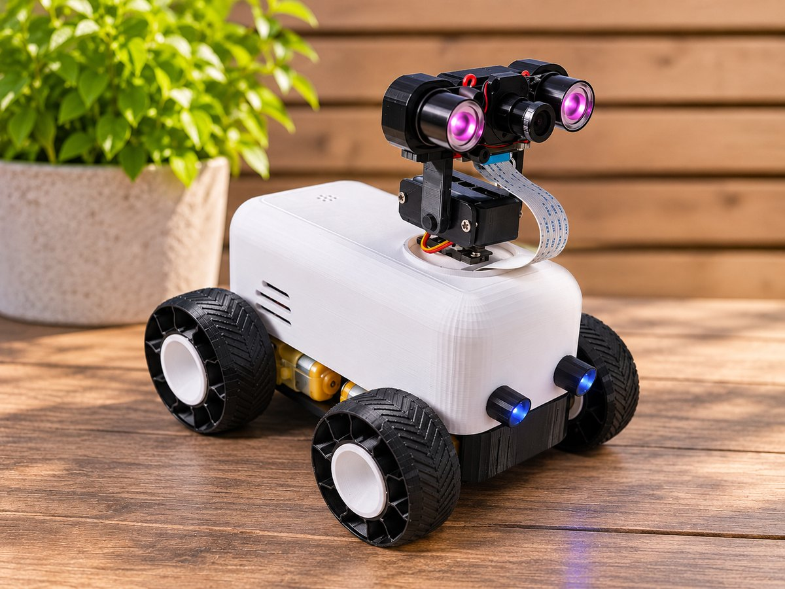
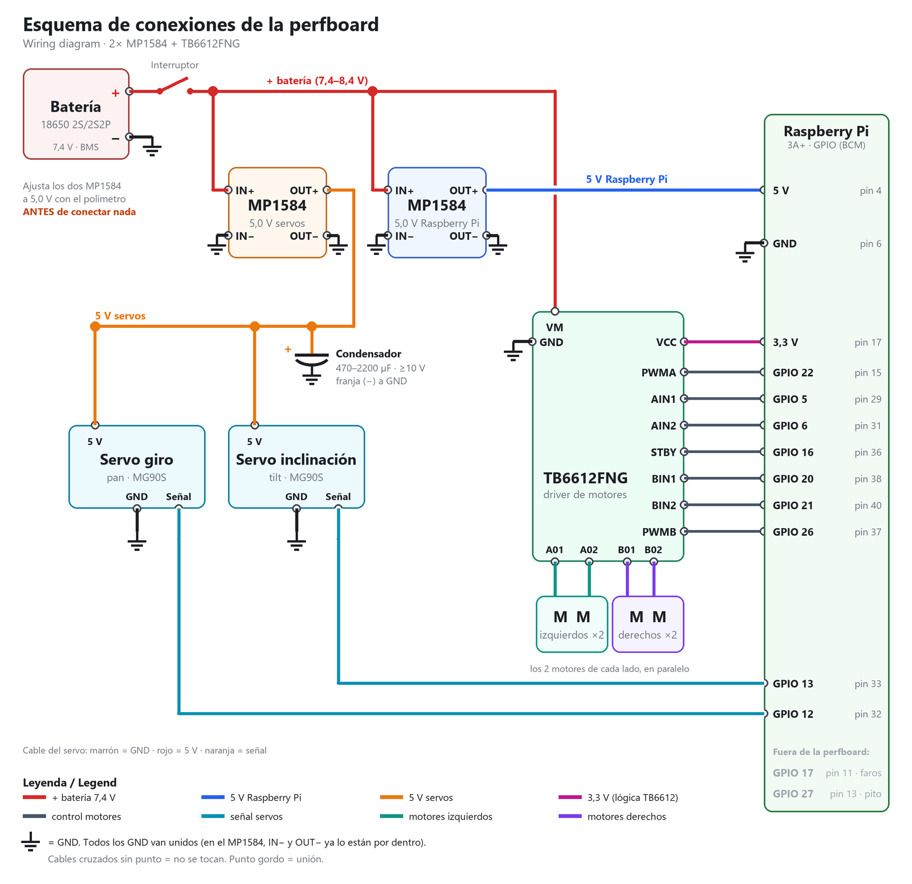

# RCWebCar · Robot mascota RC controlado desde el navegador



**ES** · Un pequeño robot con Raspberry Pi que conduces desde el móvil o el PC **sin instalar ninguna app**: abres su dirección en el navegador y tienes vídeo en directo, cabeza con pan/tilt, faros y pito.
**EN** · A small Raspberry Pi robot you drive from your phone or PC **with no app**: open its address in a browser and get live video, a pan/tilt head, headlights and a horn. *(The code comments and guides are in Spanish.)*

🖨️ **Piezas para imprimir / Printable parts:** MakerWorld *(enlace próximamente / link coming soon)*

## ✨ Qué hace / Features

- 🎮 **Mandos tipo emisora en el móvil** (acelerador a la izquierda, volante a la derecha) y teclado en el PC. / RC-transmitter style touch controls, keyboard on PC.
- 📷 **Vídeo WebRTC** con muy poco retardo; arrastra el dedo por el vídeo para mover la cabeza. / Low-latency WebRTC video; drag over it to move the head.
- 🌙 **Cámara nocturna** (OV5647 con IR-CUT): de noche en color o en blanco y negro, a elegir. / Night-vision camera.
- 💡 Faros LED y pito. / LED headlights and horn.
- 🌍 **Acceso desde Internet** (opcional): login, invitados con velocidad limitada y panel de admin para ver quién está conectado, tomar el control, echar a alguien o crear invitados. / Optional Internet access with login, guests and admin panel.
- 🛡️ Watchdog: si se pierde la conexión, los motores se paran. / Motors stop if the connection drops.

## 🚀 Instalación / Install

1. Graba **Raspberry Pi OS Lite** con **Raspberry Pi Imager** (activa SSH y tu WiFi en la personalización). / Flash Raspberry Pi OS Lite (enable SSH and WiFi).
2. Entra en la Pi por SSH y ejecuta: / SSH into the Pi and run:

   ```bash
   curl -fsSLO https://raw.githubusercontent.com/Natxo1000/RCWebCar/main/instalar.sh
   sudo bash instalar.sh
   ```

3. Contesta las preguntas (nombre, IP fija, acceso desde Internet…), reinicia y abre `http://robotrc.local:8080`. / Answer the questions, reboot and open the page.

El instalador lo deja todo listo: librerías, PWM de los servos, cámara, [MediaMTX](https://github.com/bluenviron/mediamtx), servicios que arrancan solos y, si quieres, IP fija, login y Tailscale. Para actualizar, vuelve a ejecutarlo: guarda una copia y conserva tus usuarios y tu calibración.

Guía completa (conexiones, ajustes, acceso desde Internet): **[robot_rc/LEEME.md](robot_rc/LEEME.md)**

## 🔧 Hardware

| | |
|---|---|
| Placa / Board | Raspberry Pi 3A+ |
| Motores / Motors | 4× TT 3–12 V + TB6612FNG |
| Cabeza / Head | 2× MG90S (pan/tilt) + OV5647 IR-CUT |
| Energía / Power | 18650 2S o 2S2P con BMS, 2× MP1584 a 5 V, carga USB-C |



Guías en PDF / PDF guides:
- [docs/guia_montaje.pdf](docs/guia_montaje.pdf): montaje de las piezas / assembly.
- [docs/guia_conexiones.pdf](docs/guia_conexiones.pdf): esquema, perfboard de 24×18 con pistas, cargador, faros, pito, motores, cámara y software / wiring.

## 📁 Contenido / Contents

| | |
|---|---|
| `instalar.sh` | Instalador con asistente / setup wizard |
| `robot_rc/server.py` | Servidor (aiohttp): motores, servos, faros, pito, login y watchdog |
| `robot_rc/static/` | Web de control y pantalla de login |
| `robot_rc/robot_rc.service` | Servicio de systemd |
| `docs/` | Guías en PDF e imágenes |

## 📄 Licencia / License

Código bajo licencia **MIT**: úsalo y modifícalo libremente, manteniendo el aviso de copyright. / Code under the **MIT** license.
